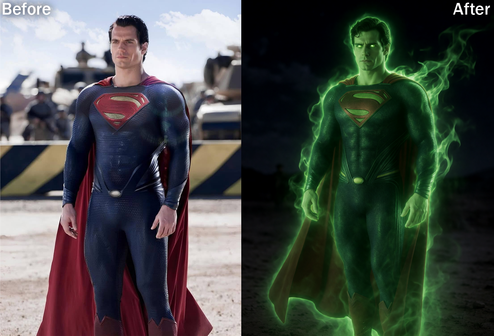

# Krea 2 Identity Edit for Forge Neo


Forge Neo extension that lets the Krea 2 Identity Edit LoRA edit an existing photo (for example, change the clothes) while keeping the person's face.

This is a fork of [opparco/sd-forge-krea2-edit](https://github.com/opparco/sd-forge-krea2-edit). It includes the compatibility fixes for Forge Neo.

## Requirements

- Forge Neo
- Krea 2 Raw or Turbo, with its Qwen3-VL text encoder and VAE
- The Identity Edit LoRA. Download [krea2_identity_edit_v1_2.safetensors](https://huggingface.co/conradlocke/krea2-identity-edit/resolve/main/krea2_identity_edit_v1_2.safetensors) (1.83 GB) and put it in `models/Lora`.

## Install

1. In Forge, open Extensions, then Install from URL, paste this repository's URL and install.
2. Restart Forge completely.
## Use

1. Select Krea 2 Turbo (or Raw).
2. Go to the **txt2img** tab (not img2img).
3. Open the **Krea 2 Identity Edit** accordion and tick its checkbox.
4. Upload your photo into **Subject reference (required)**.
5. Write the edit as an instruction and add the LoRA tag:

```
Make this person wear a white spacesuits with helmets. Keep the person's identity and facial features. <lora:krea2_identity_edit_v1_2:1>
```

6. Generate.

## Recommended settings

| Setting | Value |
|---|---|
| Model | Krea 2 Turbo |
| Steps | 10 |
| CFG | 1 |
| Size | 2 megapixels or less. At least keep the same aspect ratio as your photo, the exact pixel size does not matter |
| Grounding resolution | 768 default. Lower follows the edit more: 640, 512, 384. Higher keeps the face more: 1024, 1280, 1536 |

## Credits and license

- Original extension by [opparco](https://github.com/opparco/sd-forge-krea2-edit)
- Adapted from [lbouaraba/comfyui-krea2edit](https://github.com/lbouaraba/comfyui-krea2edit)

Licensed under Apache-2.0, see `LICENSE` and `NOTICE`.
